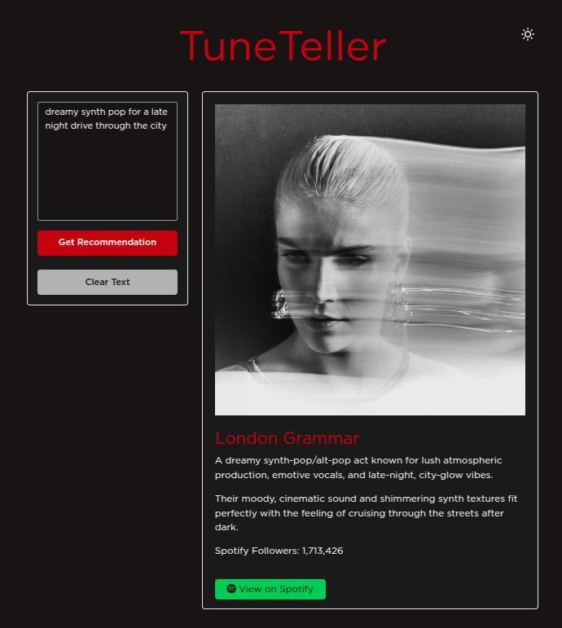

# 🎵 TuneTeller

**TuneTeller** is a Shiny web app that recommends music artists based on natural language prompts. Describe the kind of music you're in the mood for, and TuneTeller uses OpenAI to understand your request and Spotify to find the perfect artist match.

## 🔍 Features

- 🤖 Natural language music recommendations powered by OpenAI (GPT-5.4 nano)
- 🎧 Artist details fetched from Spotify API (image, followers, profile link)
- ✍️ Simple text prompt interface (190 character limit)
- 🎨 Clean UI with Spotify-inspired styling: dark by default, with a light mode switch
- 🔗 Direct link to artist's Spotify profile
- ⚡ Loading spinner while fetching recommendations
- 🛡️ Friendly messages instead of errors, a short wait between recommendations, security headers

## 📸 Screenshot



## 🚀 Live App

👉 [Try it live](https://tuneteller.youcanbeapirate.com/)

## 🛠️ Project Structure

```
TuneTeller/
├── app/
│   ├── run.R                    # App entry point (adds the security headers)
│   ├── global.R                 # Libraries; sources the files in www/
│   ├── ui.R                     # UI definition and the shared footer
│   ├── server.R                 # Reactive logic
│   └── www/
│       ├── variables.R          # Model, limits, brand colours, footer links
│       ├── strings.R            # All user-facing text
│       ├── prompt_versions.R    # OpenAI prompt versions
│       ├── api.R                # OpenAI and Spotify calls (never throw)
│       ├── functions.R          # Pure helpers (cleaning, parsing, the artist card)
│       ├── security.R           # Security headers
│       ├── cooldown.js          # Disables the button during the cooldown
│       ├── favicon.png          # Browser tab icon
│       ├── placeholder_image.png # Default image before recommendation
│       └── styles.css           # Custom styles (dark and light mode)
├── tests/testthat/              # Tests (mocked HTTP, no live API calls)
├── deploy.sh                    # Google Cloud Run deployment script
├── Dockerfile                   # Container image definition
├── docker-compose.yml           # Local development setup
├── img/                         # Images for documentation
├── renv.lock                    # Package dependencies lock file
└── renv/                        # renv package management
```

## 🔄 How It Works

1. **User Input**: You describe the music you want in a text prompt (up to 190 characters).
2. **OpenAI Processing**: The prompt is sent to GPT-5.4 nano, which interprets your request and answers in JSON with an artist, a description and a reason. Your text is passed as data, never as instructions, and OpenAI is asked not to store it.
3. **Spotify Lookup**: The recommended artist is searched on Spotify to fetch their profile image, follower count, and profile URL.
4. **Display**: The artist card is rendered with all details and a direct link to their Spotify page. If something fails, you get a plain message and can try again after a few seconds.

## 🔐 API Keys Required

This app requires API keys from both OpenAI and Spotify:

| Variable | Description |
|----------|-------------|
| `OPENAI_API_KEY` | Your OpenAI API key |
| `SPOTIFY_CLIENT_ID` | Spotify Developer app client ID |
| `SPOTIFY_CLIENT_SECRET` | Spotify Developer app client secret |

Set these as environment variables or in a `.Renviron` file.

## 🧪 Local Development

```r
# Install dependencies
renv::restore()

# Set environment variables (or use .Renviron)
Sys.setenv(OPENAI_API_KEY = "your-key")
Sys.setenv(SPOTIFY_CLIENT_ID = "your-client-id")
Sys.setenv(SPOTIFY_CLIENT_SECRET = "your-client-secret")

# Run app locally
shiny::runApp("app/")

# Run the tests (no API keys needed)
testthat::test_dir("tests/testthat")
```

## 🔐 Deployment

Deployed to Google Cloud Run. See `deploy.sh` and `DEPLOY.md` for details.

## 📦 Required R Packages

- [bslib](https://rstudio.github.io/bslib/) - Bootstrap 5 theming and the light/dark switch
- [httr2](https://httr2.r-lib.org/) - HTTP requests to the OpenAI and Spotify APIs
- [jsonlite](https://github.com/jeroen/jsonlite) - JSON parsing
- [purrr](https://purrr.tidyverse.org/) - Functional programming helpers
- [shiny](https://shiny.posit.co/) - Web application framework
- [shinycssloaders](https://daattali.com/shiny/shinycssloaders-demo/) - Loading spinners
- [stringr](https://stringr.tidyverse.org/) - String manipulation
- [testthat](https://testthat.r-lib.org/) - Tests (development only)

## 🎨 Tech Stack

| Component | Technology |
|-----------|------------|
| Language | R |
| Framework | Shiny |
| AI | OpenAI GPT-5.4 nano |
| Music Data | Spotify Web API |
| Styling | bslib + custom CSS (dark by default, light mode) |
| Deployment | Google Cloud Run |

## 📄 License

[MIT](https://opensource.org/license/mit)

## 👤 Author

Created by [Antti Rask](https://anttirask.github.io)
